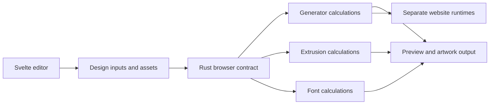

# Spielwerk shared design workspace

## Conversation Evidence

> user: "capture a spec from this prototype - ignore the code quality, I want the product intent and the requirements it demonstrates"
> user (selected): "split-as-proposed"
> user: "- **R3:** The user should be able to create responsive artboards as well"
> user: "- **R4:** Supporting mobile devices is not in scope"

## Goal & Context

Designers exploring graphic ideas can move from a tool choice to a live
composition, keep variations, and export an asset in the browser.
The designer audience and repeatable exploration workflow are inferred from
the prototype. This spec captures the common experience across the suite.
<!-- Source: 100% [inferred] -->

## Architecture & Data Models

A tool has a name, a description, editable settings, a preview, and supported
output formats. Current settings belong to that tool. A named snapshot holds
its design settings and uploaded typefaces, including an accent face where
supported. Preview zoom and panel expansion are view preferences.
<!-- Source: 100% [inferred] -->

The browser editor uses Svelte. Core geometry and computation use Rust,
compiled to WebAssembly for the browser. This is a shared architecture
choice across the workspace, graphic generators, logo extrusion, font
remixing, and responsive embeds. It does not require a Rust UI.

The engine owns tool calculations, including geometry, responsive layout,
font transformations, and animation evaluation. Browser-facing code owns
editor controls and integration with browser APIs. Preview, export, and
embed consumers use the applicable engine calculations; the embed runtime
remains separate from the editor UI. Rendering libraries, the Rust/browser
binding library, and build tooling are not selected by this decision.
<!-- Source: 80% [paraphrase] / 20% [inferred] -->

## Ownership and handoff contracts

The shared foundation supplies editor state, controls, storage, asset input,
artboard/view handling, export orchestration, static serving, and the
Rust/browser integration contract. The sibling specs supply actual tool
calculations and website runtimes.

| Owner | Delivered capability |
|---|---|
| fn-1-spielwerk-shared-design-workspace | Shared foundation and final ten-tool workspace integration |
| fn-2-spielwerk-parametric-graphic-generators | Eight generators' Rust geometry, responsive layout, timing, and artwork adapters |
| fn-3-spielwerk-logo-extrusion | Rust extrusion, materials, lighting, and motion calculations |
| fn-4-spielwerk-font-remixing | Rust glyph transformations, skeleton/stamp calculations, and font-output computation |
| fn-5-spielwerk-responsive-arrow-maze-embeds | Independent website runtimes and embed packages for all eight generators |

A tool adapter declares its control schema, defaults, dimension limits,
responsive capability, and supported output formats. Design inputs, seed,
selected layout dimensions, font/asset data, and explicit evaluation time
cross the Rust/browser boundary. Preview, artwork export, and embed playback
consume the same applicable Rust calculations. Browser adapters handle
controls, interaction events, rendering APIs, asset loading, and file output.
They must not count JavaScript computation proxies as Rust tool engines.

View zoom, pan, and panel expansion remain separate from design inputs.
Responsive export requests carry the selected preview dimensions and layout.
Embed requests carry the containing box dimensions and visual playback time.
The contract preserves fixed-board exceptions and per-tool format limits.
Concrete binding, rendering, font-processing, and encoding libraries are
selected and tested during the foundation proof point.



## Edge Cases & Constraints

The demonstrated workflow works without a user account. Snapshot storage is
browser-local on static hosting; the optional local service shares snapshots
across browsers and origins. These are distinct storage contexts, not a cloud
sync promise. Uploaded images and stamps are absent from snapshot payloads.
Folder export depends on browser and page permissions.
<!-- Source: 100% [inferred] -->

## Acceptance Criteria

The following requirements combine prototype-derived behavior with the user's
review corrections. Inferred details retain their tags.

- **R1:** Users can select any of the ten named tools, read its purpose, and open it directly or through a tool-specific link. An unrecognized link leaves the default tool available; no additional navigation error surface is demonstrated.

- **R2:** Changing grouped numeric, choice, color, text, and toggle controls updates the composition preview. Numeric sliders permit exact entry and reset. Values stay within the control's displayed range; no additional control-validation contract is inferred.

- **R3:** The user should be able to create responsive artboards as well
  - Users can set fixed artboard dimensions, use aspect presets, swap
    dimensions, and lock the ratio where the tool exposes those controls.
    Zoom and pan change the view without changing output dimensions.
    Dimension limits remain tool-specific; direct resize handles are required
    only where demonstrated.
  - Users can create a responsive artboard and preview the composition at
    different container widths and heights. The composition adapts to that
    container rather than only magnifying a fixed picture. This interpretation
    follows the prototype's responsive preview; preview resizing remains
    within the tool's supported dimension limits.

<!-- R4 retired after the user excluded mobile support. Later IDs remain unchanged. -->

- **R5:** Returning to a tool restores its last saved settings without taking another tool's settings. Missing settings use defaults. Persistence is local to the current browser context except for the optional shared snapshot service.

- **R6:** Users can save, load, overwrite by name, delete, import, and export snapshots with design settings and uploaded typefaces. Empty names receive a generated name; same-name imports overwrite; a different-tool import asks for confirmation. Snapshots omit zoom, panel expansion, images, and stamps; malformed-import recovery is not demonstrated.

- **R7:** Users can export only the formats supported by the chosen tool, with export progress where needed and a visible failure indication. Folder output is available where permitted, with normal downloads as fallback; cancelling folder selection retains the existing destination or download fallback.

- **R8:** Responsive artboards apply to Arrow Maze, Arrow Poster, Arrow Comb,
  Arrow Field, Switchboard, Truchet Tiles, Imprint, and Stripe Marquee. Logo
  Extruder and Font Remixer retain fixed artboards. Responsive previews use
  the supported dimension limits already described in R3. [paraphrase]

- **R9:** When a responsive artboard is active, ordinary artwork exports use
  its selected preview dimensions and composition layout. SVG, PNG, and GIF
  remain available only where the tool supports those formats; a downloaded
  file need not resize itself after export. Export failures retain R7's
  visible indication. [paraphrase]

- **R10:** Each of the eight graphic generators can export a website embed
  that adapts its composition to the containing box and plays its supported
  visual motion. Embeds are visual playback only. Pointer attraction,
  widget clicks, composition dragging, and text editing remain workspace
  interactions. Tools without motion display responsive still artwork.
  Supported dimensions and export-failure handling remain governed by R3
  and R7; no additional host-integration error contract is established here.
  [paraphrase]

- **R11:** The editor runs as a statically hosted browser application or
  through a local server, without a mandatory application backend. Opening
  the editor directly from a local HTML file is not required. The optional
  snapshot service remains optional; static hosting still requires serving
  the application's assets. [paraphrase]

- **R12:** Core geometry and computation use Rust compiled to WebAssembly;
  the separate browser editor UI uses Svelte. This commits to a Rust engine,
  not a Rust UI. Existing tool and output-format limits remain in force;
  the stack choice does not itself add a new user-input error surface.
  [paraphrase]

- **R13:** Identical design inputs reproduce the same composition geometry
  and animation timing. Precision concerns geometry and timing; differences
  in browser edge smoothing and rasterization are acceptable, and
  pixel-identical raster output across browsers is not required.
  [paraphrase]

- **R14:** Every displayed preview remains full fidelity throughout
  interaction. The editor must not substitute temporary lower-detail
  previews while controls are dragged. Expensive changes may update less
  frequently rather than reduce displayed quality. No specific frame rate
  or latency threshold is imposed by this decision. [paraphrase]

## Boundaries

The selected product scope has these limits.

- Supporting mobile devices is not in scope

- Capture the common browser design workflow and its demonstrated storage contexts; no new collaboration or cloud-storage workflow is specified. [inferred]
- Graphic behavior, logo extrusion, font transformation, and website embeds belong to the four sibling specs selected during capture. [paraphrase]

- Responsive artwork on websites is in scope; mobile-device support for the
  editing workspace remains out of scope. [paraphrase]

## Planning evidence and memory

The repository and spec scouts confirmed the source mechanisms behind the
prototype-derived acceptance, and the gap analyst checked the ownership
handoffs. Confirmation establishes product intent, not runtime correctness.
Actual Rust ports, browser behavior, font validity, and outputs still require
the owning tasks' checks. All active R-IDs and the retired workspace R4
remain intact.

| Track | Category | Entry | Why relevant |
|---|---|---|---|
| knowledge | decisions | rust-computation-engine-with-svelte-2026-10-13 | Rust calculations, Svelte browser UI, deterministic inputs/time, full-fidelity previews |

- Rust computation engine with Svelte browser UI sets the shared architecture;
  it makes no measured speed claim and authorizes no saved-data loss.

## Early proof point

Task fn-1-spielwerk-shared-design-workspace.3 proves a statically served
Svelte editor can call actual Rust/WebAssembly computation with deterministic
inputs and explicit time. If it fails, re-evaluate the build/binding and
rendering contract before implementing the remaining foundation or sibling
engines. An internal computation fixture proves the boundary; it does not
claim delivery of any named tool.

## Delivery milestones and release gates

The foundation tasks precede sibling calculations. Full workspace acceptance
still requires every active R-ID, including the actual eight-tool embeds and
Rust-owned tool calculations.

1. Complete foundation tasks .2 through .6 and verify their build, storage,
   control, artboard, and export evidence.
2. Release blocked entry tasks in fn-2, fn-3, and fn-4 against those foundation
   receipts. The workspace spec remains open.
3. Release fn-5 against fn-2's generator handoff tasks .1 through .6.
   Generator delivery leaves fn-2's final embed acceptance outstanding.
4. Complete fn-5, then release fn-2's final task .7 to verify the delivered
   generator catalog with the actual embed packages.
5. Release the existing blocked owner
   fn-1-spielwerk-shared-design-workspace.1 only after foundation evidence and
   completed fn-2, fn-3, fn-4, and fn-5 evidence have been checked. Its
   whole-spec acceptance, identity, R-ID mapping, and blocker history remain
   intact. It owns final workspace integration, not sibling algorithm ports.

Flow task dependencies are same-spec only. Whole-spec dependencies that
would also block their prerequisite-producing tasks are removed. Cross-spec
milestones use explicit task blocks stored through flowctl. They do not
automatically unblock. Before an authorized release, check prerequisite task
statuses, commit ranges present in the consumer checkout, focused test
results, applicable review receipts or recorded configuration skips, and
remaining limitations. Preserve the block history before a task reset,
which clears runtime blocker/evidence fields. Never release a gate on a
coverage declaration, scaffold, or planned command alone.

Use a checkout containing completed prerequisite commits throughout these
handoffs. An unrelated branch with only task-state receipts is insufficient.
Planning records these gates; it neither approves implementation nor grants
authority to mark tasks/specs done, push, or deploy.

## Quick commands

The foundation bootstrap establishes these planned application gates and
records the current absent-manifest baseline honestly. None has run yet.
Later tasks run the focused gate for their changed behavior; final integration
runs the workspace integration gate against real sibling implementations.

```bash
npm run build
npm run test:workspace
npm run test:integration
cargo test --manifest-path crates/spielwerk-engine/Cargo.toml workspace
```

## Decision Context

The user selected five specs after reviewing the proposed product boundaries.
All siblings share the prototype as their origin. This workspace is the common
experience dependency for graphic generators, logo extrusion, and font
remixing. Extracted behavior remains inferred product intent until reviewed.
<!-- Source: 50% [paraphrase] / 50% [inferred] -->

Responsive artboards adapt the artwork to a container. They do not require
mobile-device support for the editing workspace. [paraphrase]

Responsive artboards cover the eight graphic generators. The user chose
responsive website embeds for all eight, with visual playback only, and
ordinary artwork exports that match the selected responsive preview.
Logo extrusion and font remixing keep fixed artboards. These choices extend
the captured prototype behavior. [paraphrase]

The graphic-generator and responsive embed specs carry this shared product
contract. The existing split owns tool-specific artwork and website
integration; this spec defines the shared responsive-artboard and output
requirements and verifies their final integration. Foundation completion is
an intermediate handoff, not completion of this spec. [paraphrase]

The user approved preserving the five-spec split and planning foundation,
sibling engines, embeds, and final integration in that order. The user also
approved planned execution while preserving the existing blocked owner as
the final whole-workspace acceptance gate. No product requirement is removed
or narrowed by that scheduling decision. [user]

The user chose a static-hosted app, a Rust computation engine, and Svelte
for the browser UI. The prototype supplies product evidence, not an
implementation constraint. Its no-build packaging, framework choices, and
single-page-per-tool structure do not dictate the new architecture.

The priority is precise results and speed. Precision means deterministic
geometry and timing, not pixel-identical rendering across browsers.
Full fidelity takes precedence over adaptive lower-detail previews.
Optimize speed within those constraints. No benchmark has established
a Rust performance advantage here, and no numeric performance budget
was supplied.

The language decision does not select a full rewrite, a new saved-data
format, or a migration policy. Existing persistence requirements remain
in force. Revisit saved-work compatibility if a breaking storage change
is proposed; this interview neither promises migration nor permits data
loss. The remaining rendering, font-processing, encoding, and browser
integration library choices need engineering investigation.
<!-- Source: 100% [paraphrase] -->

## Resolved via Codebase

- Arrow Maze already distinguishes fixed artboard dimensions from a
  responsive preview box and regenerates the preview for that box.
  Evidence: tools/arrow-maze.html:473-490. Retain that distinction as the
  baseline for interpreting responsive artboards, rather than treating
  ordinary preview zoom as responsive composition.
- Existing Arrow Maze SVG, PNG, and GIF exports use the fixed artboard
  scene even during responsive preview. Evidence:
  tools/arrow-maze.html:484-486,554-556,620-626. The user's selected-preview
  export decision changes that behavior rather than describing it as
  already implemented.

## Resolved via Project Docs

- Snapshot storage has an optional local-service context and a
  browser-local fallback. Evidence: README.md:43-47. Retain both contexts
  without interpreting the shared service as cloud synchronization.
- The documented responsive preview models a website-sized box that
  relays out the composition when resized. Evidence: CLAUDE.md:98-104.
  Use responsive layout as the artboard meaning; this does not require
  mobile-device support for the editor.
- The prototype documentation promises single-page tools without a build
  and supports direct local-file opening. Evidence: README.md:3-4.
  Record this as the prototype baseline, not a constraint on the approved
  statically hosted Svelte and Rust/WebAssembly architecture.

## Resolved via Research
<!-- provenance: refine --scope=research (docs-scout, practice-scout, docs-gap-scout, memory-scout) on 2026-10-13; plan writes the same section when its Step 1 ran docs-scout or practice-scout -->

### docs-scout
- **Svelte client UI** - Svelte compiles components into JavaScript.
  The current documentation uses `mount(App, {target, props})` for a
  browser root; the approved static editor does not require SvelteKit or
  server rendering. Source: https://svelte.dev/docs/svelte/overview,
  https://svelte.dev/docs/svelte/imperative-component-api
- **Candidate Rust/browser bindings** - If wasm-bindgen is selected,
  `--target web` emits directly browser-loadable ES-module glue;
  `--target bundler` expects bundler integration. Confirm integration
  against the chosen tooling before implementation. Source:
  https://rustwasm.github.io/docs/wasm-bindgen/reference/deployment.html
- **Static Wasm hosting** - `WebAssembly.instantiateStreaming(source,
  importObject?)` resolves to a module and instance, requires an
  `application/wasm` response, and can be blocked by restrictive Content
  Security Policy. Verify the selected host and embed host policies.
  Exact policy directives were not researched in this pass. Source:
  https://developer.mozilla.org/en-US/docs/WebAssembly/Reference/JavaScript_interface/instantiateStreaming_static
- **Responsive containers** - `new ResizeObserver(callback).observe(element)`
  reports container-size changes independently of viewport resizing.
  Supply those dimensions to engine layout for responsive artboards and
  embeds; disconnect observations when their consumer is removed. Source:
  https://developer.mozilla.org/en-US/docs/Web/API/ResizeObserver
- **Version anchor unavailable** - The manifest scan found no application
  `package.json` or `Cargo.toml`; no product dependency version can be
  confirmed. Validate mounting and binding APIs once versions are selected.
  Bindings, rendering, and build tooling remain unselected. Source:
  .flow/specs/fn-1-spielwerk-shared-design-workspace.md:35-36,
  https://svelte.dev/docs/svelte/imperative-component-api

### practice-scout
- **Folder export** - Feature-detect `showDirectoryPicker()`; it has limited
  browser support, needs a secure context and user activation, and defaults
  to read-only access. Request write access for folder output and preserve
  R7's existing destination or download fallback on cancellation. Source:
  https://developer.mozilla.org/en-US/docs/Web/API/Window/showDirectoryPicker
- **Local persistence** - `localStorage` is origin-scoped, access can throw
  when persistence is blocked, and private-session data is cleared when the
  last private tab closes. Keep per-tool settings separate from the optional
  cross-browser snapshot service; this finding does not select snapshot
  storage technology. Source:
  https://developer.mozilla.org/en-US/docs/Web/API/Window/localStorage
- **Resize feedback** - Avoid observer callbacks that repeatedly resize the
  observed container. Deferring writes to animation frames alone does not
  remove a cyclic size dependency. Source:
  https://developer.mozilla.org/en-US/docs/Web/API/ResizeObserver
- **Deterministic playback** - Use animation-frame timestamps rather than
  callback counts; refresh rates vary and hidden tabs pause callbacks.
  Keep browser scheduling separate from engine time so fewer full-fidelity
  updates preserve evaluation for identical design inputs and time. Source:
  https://developer.mozilla.org/en-US/docs/Web/API/Window/requestAnimationFrame,
  .flow/specs/fn-1-spielwerk-shared-design-workspace.md:109-119

### docs-gap-scout
- **Docs that must change:** `README.md` and `CLAUDE.md` - When the approved
  architecture lands, replace prototype no-build/local-file and page-copy
  instructions with the selected Svelte/Rust-Wasm build and serving steps;
  distinguish mobile editor support from responsive website artwork.
  Source: README.md:3-14,37-47; CLAUDE.md:3-16
- **Docs that must change:** `CLAUDE.md` and `README.md` - Separate per-tool
  settings and view preferences from snapshot payloads; document snapshot
  typefaces, image/stamp exclusions, browser-local storage, and the optional
  local service. Replace the blanket "persist everything" guidance.
  Source: CLAUDE.md:30-47; README.md:43-47
- **Docs that must change:** `README.md` and `CLAUDE.md` - Expand
  Arrow-Maze-only responsive guidance to the eight generators, selected-preview
  artwork exports, and separate visual-only embeds. Treat p5 and shared
  JavaScript-runtime conventions as prototype evidence.
  Source: README.md:16-35; CLAUDE.md:86-105
- **Docs that must change:** `CLAUDE.md` - Describe deterministic geometry
  and timing, permitted raster differences, full-fidelity interaction
  previews, and permission-dependent folder exports with download fallback
  and visible failures. Source: CLAUDE.md:73-84,107-114;
  .flow/specs/fn-1-spielwerk-shared-design-workspace.md:75,109-119

### memory-scout
- **Rust computation engine with Svelte** - The recorded decision assigns
  core computation to Rust/Wasm and browser UI to Svelte; bindings, rendering,
  and build tooling remain unselected. Source:
  knowledge/decisions/rust-computation-engine-with-svelte-2026-10-13

## Requirement coverage

| Req | Description | Task(s) | Gap justification |
| --- | --- | --- | --- |
| R1 | Users can select any of the ten named tools, read its purpose, and open it directly or through a tool-specific link. An unrecognized link leaves the default tool available; no additional navigation error surface is demonstrated. | fn-1-spielwerk-shared-design-workspace.1, fn-1-spielwerk-shared-design-workspace.5 | — |
| R2 | Changing grouped numeric, choice, color, text, and toggle controls updates the composition preview. Numeric sliders permit exact entry and reset. Values stay within the control's displayed range; no additional control-validation contract is inferred. | fn-1-spielwerk-shared-design-workspace.1, fn-1-spielwerk-shared-design-workspace.5 | — |
| R3 | The user should be able to create responsive artboards as well | fn-1-spielwerk-shared-design-workspace.1, fn-1-spielwerk-shared-design-workspace.5 | — |
| R5 | Returning to a tool restores its last saved settings without taking another tool's settings. Missing settings use defaults. Persistence is local to the current browser context except for the optional shared snapshot service. | fn-1-spielwerk-shared-design-workspace.1, fn-1-spielwerk-shared-design-workspace.4 | — |
| R6 | Users can save, load, overwrite by name, delete, import, and export snapshots with design settings and uploaded typefaces. Empty names receive a generated name; same-name imports overwrite; a different-tool import asks for confirmation. Snapshots omit zoom, panel expansion, images, and stamps; malformed-import recovery is not demonstrated. | fn-1-spielwerk-shared-design-workspace.1, fn-1-spielwerk-shared-design-workspace.4 | — |
| R7 | Users can export only the formats supported by the chosen tool, with export progress where needed and a visible failure indication. Folder output is available where permitted, with normal downloads as fallback; cancelling folder selection retains the existing destination or download fallback. | fn-1-spielwerk-shared-design-workspace.1, fn-1-spielwerk-shared-design-workspace.6 | — |
| R8 | Responsive artboards apply to Arrow Maze, Arrow Poster, Arrow Comb, Arrow Field, Switchboard, Truchet Tiles, Imprint, and Stripe Marquee. Logo Extruder and Font Remixer retain fixed artboards. Responsive previews use the supported dimension limits already described in R3. | fn-1-spielwerk-shared-design-workspace.1, fn-1-spielwerk-shared-design-workspace.5 | — |
| R9 | When a responsive artboard is active, ordinary artwork exports use its selected preview dimensions and composition layout. SVG, PNG, and GIF remain available only where the tool supports those formats; a downloaded file need not resize itself after export. Export failures retain R7's visible indication. | fn-1-spielwerk-shared-design-workspace.1, fn-1-spielwerk-shared-design-workspace.6 | — |
| R10 | Each of the eight graphic generators can export a website embed that adapts its composition to the containing box and plays its supported visual motion. Embeds are visual playback only. Pointer attraction, widget clicks, composition dragging, and text editing remain workspace interactions. Tools without motion display responsive still artwork. Supported dimensions and export-failure handling remain governed by R3 and R7; no additional host-integration error contract is established here. | fn-1-spielwerk-shared-design-workspace.1 | — |
| R11 | The editor runs as a statically hosted browser application or through a local server, without a mandatory application backend. Opening the editor directly from a local HTML file is not required. The optional snapshot service remains optional; static hosting still requires serving the application's assets. | fn-1-spielwerk-shared-design-workspace.1, fn-1-spielwerk-shared-design-workspace.2, fn-1-spielwerk-shared-design-workspace.3, fn-1-spielwerk-shared-design-workspace.6 | — |
| R12 | Core geometry and computation use Rust compiled to WebAssembly; the separate browser editor UI uses Svelte. This commits to a Rust engine, not a Rust UI. Existing tool and output-format limits remain in force; the stack choice does not itself add a new user-input error surface. | fn-1-spielwerk-shared-design-workspace.1, fn-1-spielwerk-shared-design-workspace.3 | — |
| R13 | Identical design inputs reproduce the same composition geometry and animation timing. Precision concerns geometry and timing; differences in browser edge smoothing and rasterization are acceptable, and pixel-identical raster output across browsers is not required. | fn-1-spielwerk-shared-design-workspace.1, fn-1-spielwerk-shared-design-workspace.3 | — |
| R14 | Every displayed preview remains full fidelity throughout interaction. The editor must not substitute temporary lower-detail previews while controls are dragged. Expensive changes may update less frequently rather than reduce displayed quality. No specific frame rate or latency threshold is imposed by this decision. | fn-1-spielwerk-shared-design-workspace.1, fn-1-spielwerk-shared-design-workspace.5 | — |
